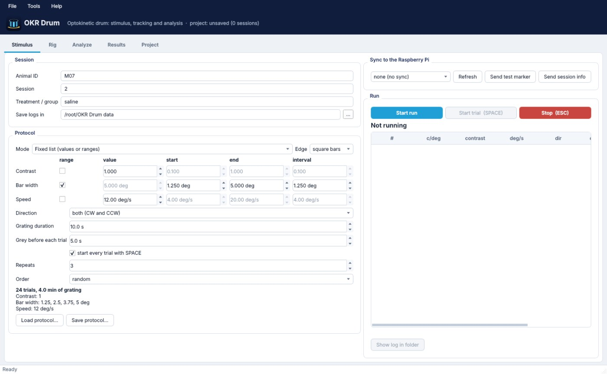
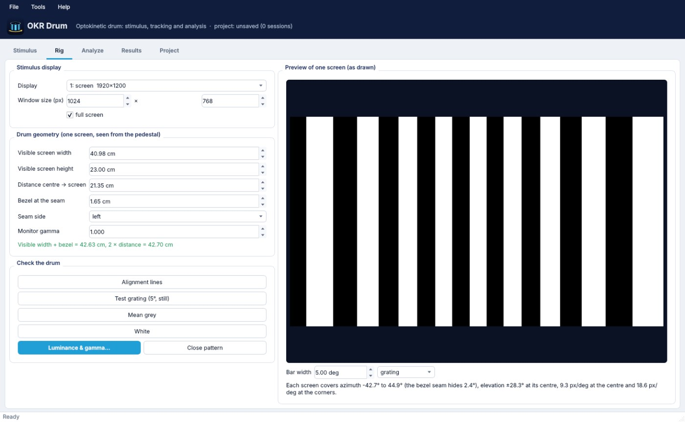
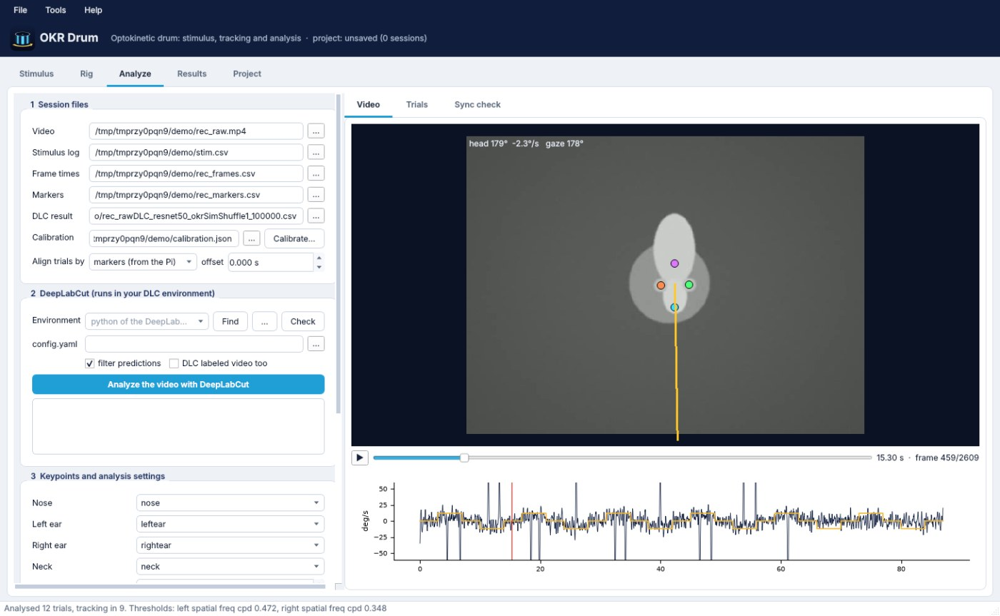
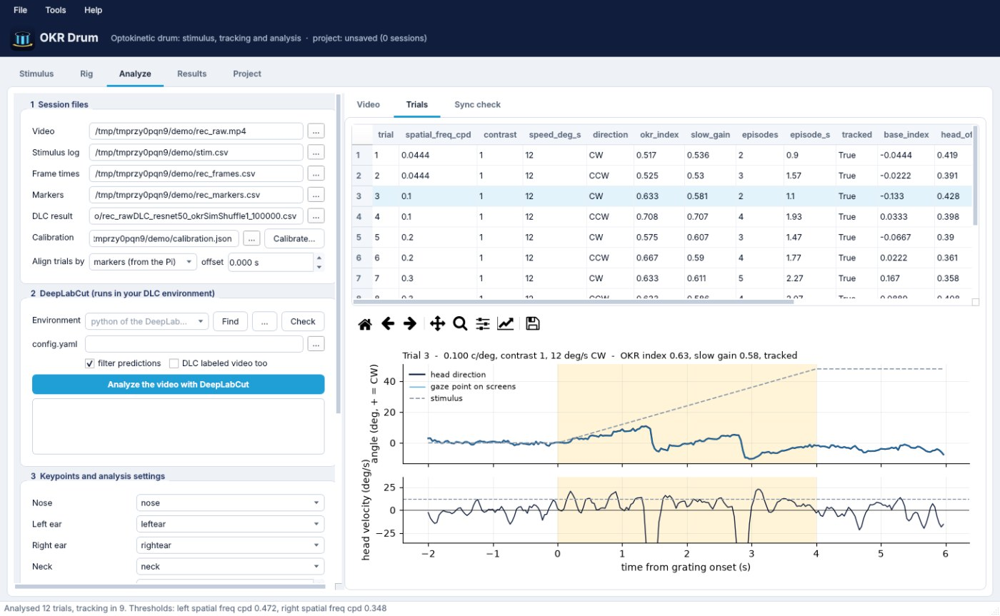
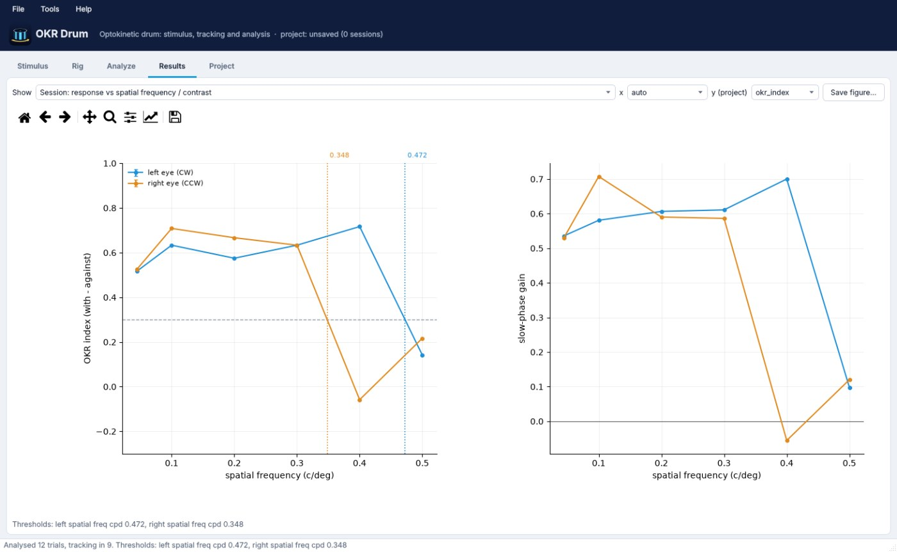
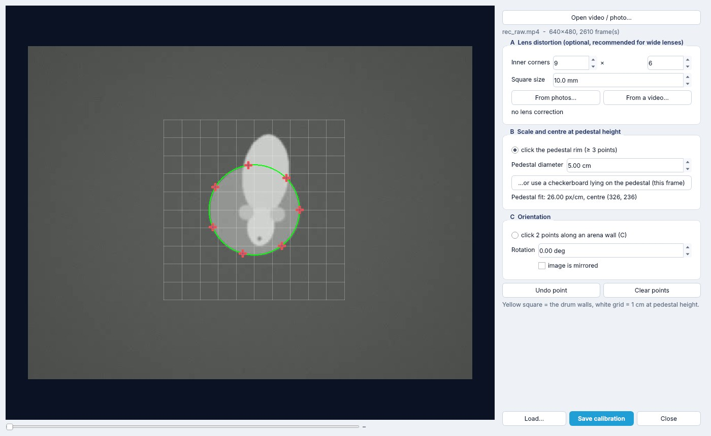
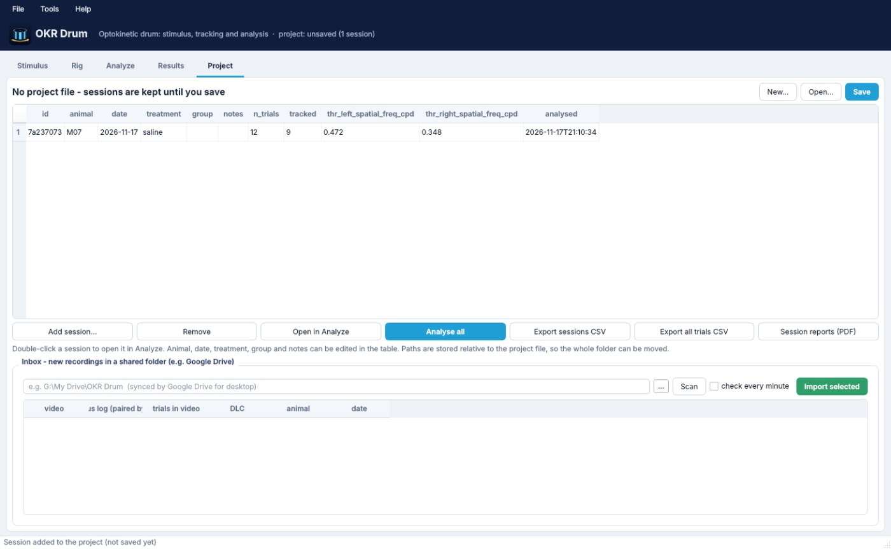
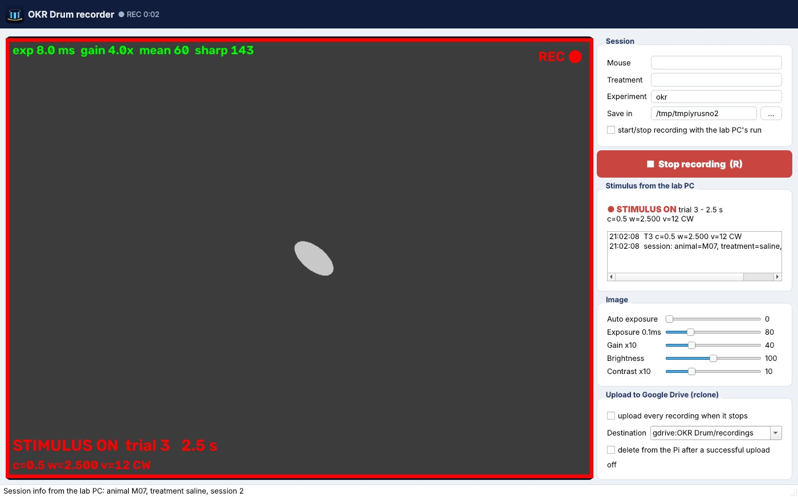

# OKR Drum

A virtual optokinetic drum for mice: four monitors around the animal show a moving grating, a camera on a Raspberry Pi films the head from above, and one desktop app runs the stimulus, calibrates the camera, analyses DeepLabCut head tracking and draws the response graphs.

- **Stimulus**: perspective-corrected square or sine gratings drawn with OpenGL and locked to the screen refresh. Fixed lists, value ranges or an automatic acuity staircase. Every grating onset and end is sent to the Pi as a serial marker.
- **Recorder (Raspberry Pi)**: records the overhead IR camera at a fixed frame rate and matches every marker to a video frame. It gets the mouse name and treatment from the stimulus PC, can start and stop with the run, and can upload each recording to Google Drive.
- **Analysis**: runs your trained DeepLabCut model (nose, left ear, right ear, neck) from the app. It works out where the head points, extends that line to the screens and measures sideways gaze movement during each grating. Head turns are then compared with the stimulus speed: OKR index, slow-phase gain, tracking episodes, and an acuity threshold for each eye.
- **Tools**: camera calibration, screen alignment pattern, photometer gamma fit, a sync check, overlay videos, PDF reports and a project database with an Inbox for new recordings.

## Screenshots










## Install

Download from the [latest release](https://github.com/jerjely/OKR-Drum/releases/latest):

| Computer | File | How |
|---|---|---|
| Windows 10/11 (stimulus PC, analysis) | `OKR-Drum-<version>-Windows-setup.exe` | Run it. It installs for your user only, so no admin rights are needed. If SmartScreen warns you, click **More info → Run anyway**. |
| Mac with an M-series chip | `OKR-Drum-<version>-macOS-AppleSilicon.pkg` | Open it. It installs into Applications. If macOS blocks it, go to **System Settings → Privacy & Security → Open Anyway**. |
| Mac with an Intel chip | `OKR-Drum-<version>-macOS-Intel.pkg` | Same as above. |
| Raspberry Pi 4/5 (camera) | `OKR-Drum-<version>-RaspberryPi.deb` | `sudo apt install ./OKR-Drum-<version>-RaspberryPi.deb`, then run `sudo okr-recorder-setup` once and reboot. **OKR Drum recorder** appears in the applications menu. |
| Building the drum | `OKR-Drum-<version>-Hardware.zip` | Blueprint and parts list (also in [hardware/](hardware/)). |

The installers are not signed, so the first time you open one you will see the warnings above.

### Also needed alongside

These are not in the installers because they depend on drivers, GPUs or accounts:

- **DeepLabCut** in its own conda environment, used only for analysis. Train the model wherever you like. In the Analyze tab, point the app at that environment's Python (**Find** looks in the usual Miniconda/Anaconda places) and at the project's `config.yaml`. You can also bring a DLC `.h5`/`.csv` you made elsewhere.
- **USB-to-TTL serial adapter** (e.g. CH340/CH341, 3.3 V) from the stimulus PC to the Pi's GPIO 14/15 (TX→RX, RX→TX, GND→GND). On Windows, install the adapter's driver if it doesn't appear in the port list.
- **Google Drive sharing** (optional):
  - On the Pi: `rclone config` once (as your normal user) to make a remote called `gdrive`, then tick **upload every recording when it stops** in the recorder. Recordings go to `gdrive:OKR Drum/recordings/<date>/`, with a retry queue if the network drops. OneDrive also works through rclone.
  - On the PC: install **Google Drive for desktop**, set the stimulus logs folder inside the Drive folder, and point the Project tab's **Inbox** at it. New recordings are paired with their stimulus logs automatically.
- A Raspberry Pi **HQ camera** with an IR-capable lens and IR lighting, and the four monitors set up as one extended desktop (see [hardware/](hardware/)).

## How a session runs

1. **Rig tab** (once per setup): enter the monitor geometry, show the alignment pattern and line up the screens, then measure the gamma with a photometer.
2. **Tools → Camera calibration** (once per camera position): photograph a checkerboard for the lens, click the pedestal rim for scale, and click two wall points for orientation.
3. **Stimulus tab**: enter the animal and treatment, choose the protocol, pick the serial port and press **Start run**. The Pi fills in the same session details and, if **start/stop recording with the lab PC's run** is ticked, records the run by itself.
4. **Analyze tab**: open the Pi video. The stimulus log, frame times, markers and calibration are found next to it. Run DeepLabCut, then **Analyze**. Check the **Sync check** tab, then save the CSVs, PDF report or an overlay video.
5. **Project / Results**: collect sessions by animal, treatment and group, compare tuning curves and thresholds, and export everything.

### Serial messages (PC → Pi, 115200 baud, one line each)

| Line | Meaning |
|---|---|
| `S {"animal":"M07","treatment":"saline",...}` | run start: session details (JSON) |
| `T3 c=1 w=2.500 v=12 CW` | grating 3 starts: contrast, bar width (deg), speed (deg/s), direction |
| `E3` | grating 3 ends |
| `X` | run end |

## Files

- **Stimulus PC**: `<animal>_s<session>_<time>.csv` (one row per grating with onset/end times and frame timing), `_settings.json` (rig and protocol), and `_staircase.json` for staircase runs.
- **Pi**: `<time>_<mouse>_<treatment>_<experiment>_<date-time>_raw.mp4` plus `_frames.csv`, `_markers.csv` and `_info.json`.
- **Analysis**: `<video>_okr_trials.csv`, `_okr_summary.csv`, `_okr_frames.csv`, `_session.json`, an optional PDF report and an overlay video.

## Install from source

You need Python 3.10–3.13. Then:

- **Windows**: double-click `install_windows.bat`, then `run_windows.bat`.
- **Mac**: double-click `install_mac.command`, then `run_mac.command`. If macOS refuses, right-click → Open.
- **Any system**:
  ```
  python -m venv .venv
  source .venv/bin/activate        # Windows: .venv\Scripts\activate
  pip install -r requirements.txt
  python okr_drum.py
  ```

To check everything works, run `python okr_drum.py --selftest selftest.txt`. It tests the geometry, staircase, OpenGL shader, markers, a full synthetic analysis, calibration and the app window, and returns exit code 0 when it passes. The same check is under **Help → Run self-test**.

To run the Raspberry Pi recorder from source, use `python3 pi_app/run.py` (it needs `python3-pyqt5 python3-picamera2 python3-opencv python3-serial`). Its self-test is `python3 pi_app/run.py --selftest`, which simulates the camera and the serial line.

## How to release

1. Commit and push your changes (GitHub Desktop is fine).
2. On GitHub, go to **Actions → Build installers → Run workflow** and type a version such as `1.2.0`. Alternatively, push a tag `v1.2.0`.
3. The workflow:
   - builds the app on Windows, Apple Silicon and Intel Macs;
   - runs the self-test on each built app;
   - builds the installers, installs them and runs the self-test again on the installed apps;
   - builds and tests the Raspberry Pi `.deb` and zips the hardware folder;
   - publishes release `v1.2.0` with all five files.
4. If you run the workflow with the version left empty, it only builds and tests. The installers are kept as workflow artifacts for a few days.

The version is written into the app from the tag and shows in **Help → About**.

## Repository layout

```
okr_drum.py            app entry point
okrdrum/               desktop app (stimulus, renderer, analysis, GUI)
pi_app/                Raspberry Pi recorder
install/               PyInstaller spec, Inno Setup script, self-test runner
tools/build_deb.sh     builds the Raspberry Pi package
hardware/              drum blueprint
legacy/                the original PsychoPy / Thonny scripts
```

## License

MIT, © Gergely Szarka. See [LICENSE](LICENSE).
