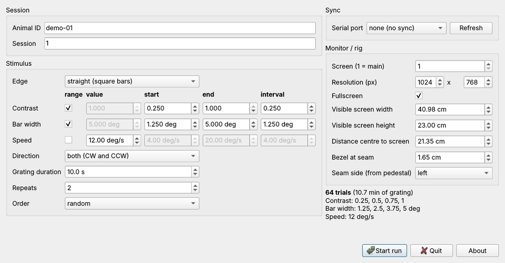
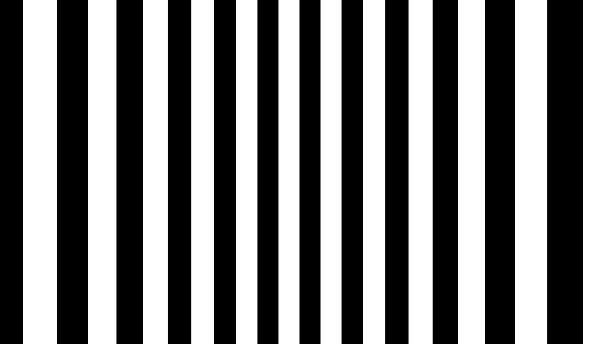
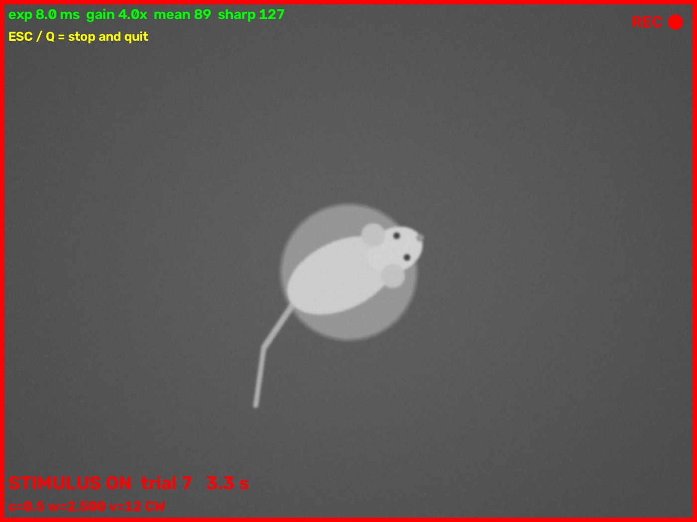
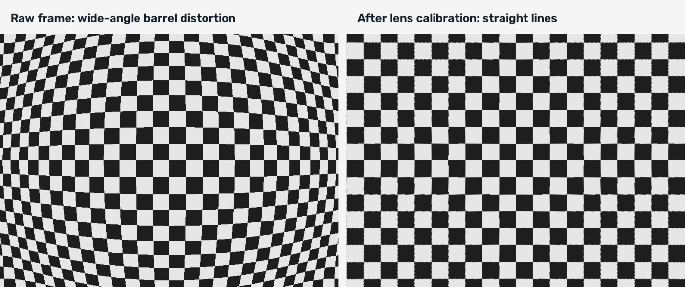
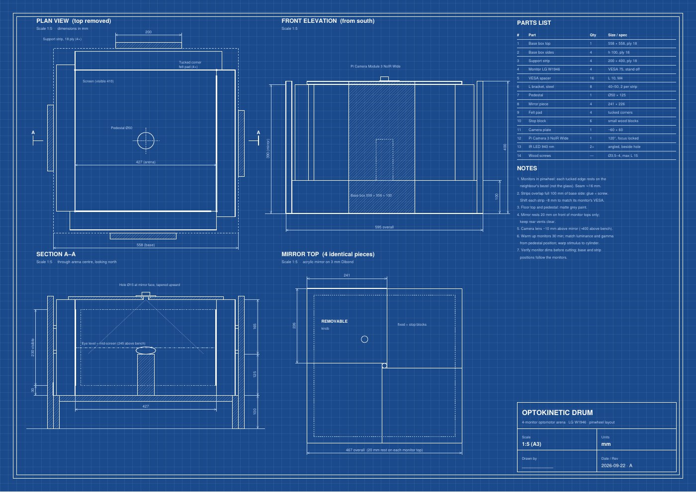

# OKR Drum

A four-monitor optokinetic drum for mice: the lab PC draws drifting gratings that are
warped so bar width and speed are true degrees seen from the pedestal, a Raspberry Pi
records the animal with an overhead IR camera and logs exactly when each grating ran,
and a calibration tool converts DeepLabCut tracking into centimetres.

## Screenshots

## What's in it

| Part | Runs on | What it does |
|---|---|---|
| **Stimulus** – `stimulus/okr_gui_experiment.py` | Lab PC (Windows or Mac) with PsychoPy | Settings window (single values or ranges for contrast, bar width, speed; direction, duration, repeats, order; monitor geometry). SPACE starts each trial, ESC returns to the settings. Gratings are warped for the flat screens and fit a whole number of cycles per screen so stripes meet at the corners. Sends `T<n> c=… w=… v=… CW` at grating onset and `E<n>` at its end over a USB-serial adapter. One CSV per run in `data/`. |
| **Raspberry Pi** – `raspberry_pi/okr_record_pi.py` | Raspberry Pi + HQ Camera / Camera Module | Grayscale recording at a fixed frame rate, sliders for exposure, gain, brightness, contrast, a focus aid, live "STIMULUS ON" feedback, per-frame timestamps and trial numbers, markers matched to video frames. |
| **Analysis** – `analysis/okr_camera_calibration.py` | Any PC | Lens calibration (checkerboard), pixel → cm at pedestal height, DeepLabCut CSV → cm centred on the pedestal. |
| **Hardware** – `hardware/` | – | A3 build drawing (1:5) and build / wiring notes. |

## Install

Download from the [latest release](https://github.com/jerjely/OKR-Drum/releases/latest):

| File | Where | How |
|---|---|---|
| `OKR-Drum-<version>-Stimulus.zip` | Lab PC that drives the monitors | Install [Miniconda](https://docs.conda.io/projects/miniconda), unzip, double-click `install_windows.bat` (Windows: per-user, no admin, Start-menu entry, optional desktop shortcut) or `install_mac.command` (Mac). Then start **OKR Drum** from the Start menu / `run_okr.bat` / `run_okr.command`. |
| `OKR-Drum-<version>-RaspberryPi.zip` | Raspberry Pi with the camera | Unzip, `bash install_pi.sh`, reboot, open `okr_record_pi.py` in Thonny and Run. |
| `OKR-Drum-<version>-Analysis.zip` | Any PC | Unzip, `pip install -r requirements.txt`, see its README. |
| `OKR-Drum-<version>-Hardware.zip` | Workshop | Build drawing and wiring notes. Print the PDF on A3 at 100 %. |

**Why zips and not installers:** the stimulus needs PsychoPy, which has its own drivers
and is far too large to bundle; the recorder needs the Raspberry Pi camera stack. The
install scripts put these in place instead (PsychoPy in a conda environment called
`okr`, picamera2/OpenCV/pyserial from Raspberry Pi OS). Everything else works without
them: the settings window and all self-tests run on any computer.

**Unsigned scripts:** Windows may stop a `.bat` with SmartScreen → **More info → Run
anyway**. A Mac may block a `.command` → **System Settings → Privacy & Security → Open
Anyway**.

### Also needed alongside
- **Miniconda** on the lab PC (PsychoPy is installed into it by the script).
- **A USB-TTL serial adapter** (e.g. CH340/CH341, set to 3.3 V and TTL) between the lab
  PC and the Pi: TXD → Pi pin 10, RXD → pin 8, GND → pin 6. On a Pi 5 the port is
  `/dev/ttyAMA0` and needs `dtparam=uart0=on` (the Pi install script adds it).
- **A powered 1-to-4 VGA splitter** if the four monitors share one video output.
- **DeepLabCut** (separate install) if you track the videos.

## Install from source (development)

    git clone https://github.com/jerjely/OKR-Drum
    cd OKR-Drum
    conda create -n okr python=3.10 -y && conda activate okr
    pip install -r requirements.txt
    python stimulus/okr_gui_experiment.py

The original launch scripts still work from the repository: `stimulus/run_okr.bat`
(Windows, finds Miniconda and the `okr` environment), `stimulus/install_windows.bat`,
`stimulus/install_mac.command`, `stimulus/run_okr.command`, `raspberry_pi/install_pi.sh`.

Self-tests (no rig, camera or PsychoPy needed):

    python stimulus/okr_gui_experiment.py --selftest
    python raspberry_pi/okr_record_pi.py --selftest
    python analysis/okr_camera_calibration.py --selftest
    # with PsychoPy drawing two real gratings (Linux: under xvfb-run)
    python stimulus/okr_gui_experiment.py --selftest --render

## Making a release

Either push a tag:

    git tag v1.0.0 && git push origin v1.0.0

(in GitHub Desktop: History → right-click the commit → Create Tag… `v1.0.0` → Push origin),
or open **Actions → Build installers → Run workflow** and type the version (e.g. `1.0.0`);
the workflow then creates the tag and the release itself. With the box left empty it only
builds and tests.

The workflow (`.github/workflows/build-installers.yml`) builds the four zips with the
version stamped into every script (shown in the settings window title, **About**, and
`--version`), unpacks them and runs all self-tests on Windows, macOS 15 (Apple silicon),
macOS 15 Intel and – with real PsychoPy drawing – Linux. Only if all pass are the zips
attached to the release.

## Licence

MIT © Gergely Szarka
