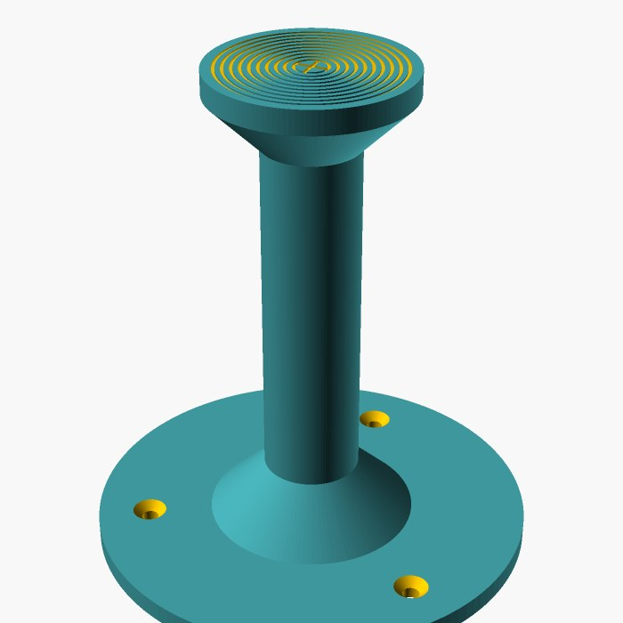

# Mouse pedestal (3D print)

One piece, 125 mm tall, printed upright with no supports. The mouse stands on a 50 mm platform that overhangs a 24 mm stem; the overhang keeps mice from climbing down. Standing on the 10 cm drum base, the platform puts the eyes at mid-screen.

- `okr_pedestal.stl` – ready to slice.
- `okr_pedestal.scad` – editable in [OpenSCAD](https://openscad.org): change the numbers at the top (height, platform size, foot, screw holes, grip grooves), then **Render (F6)** and **File → Export → STL**.

## Print settings
| | |
|---|---|
| Material | PETG (best for wiping with 70 % ethanol) or PLA; **matte light grey** so a dark mouse stands out on camera |
| Orientation | upright, foot on the bed, as exported |
| Layer height | 0.2 mm (ironing the top surface is optional) |
| Walls / infill | 3–4 walls, 15–20 % infill |
| Supports | none (the cone under the platform is 45°) |
| Size | 110 × 110 × 125 mm, fits a 18 × 18 cm bed |

## Fitting
- Find the centre of the drum floor (diagonals of the arena square) and screw the foot down with three 4 mm countersunk wood screws.
- On a floor mirror or anything you can't screw into, use strong double-sided tape, or set `magnet_pockets = 3` and glue in 10 × 3 mm disc magnets over a steel plate.
- The top edge is deliberately sharp: the camera calibration tool clicks this rim and assumes a 50 mm diameter. If you change `platform_d`, enter the new diameter in the calibration tool.
- The grip grooves are 0.4 mm deep. If they collect dirt, set `grip_rings = false`.
